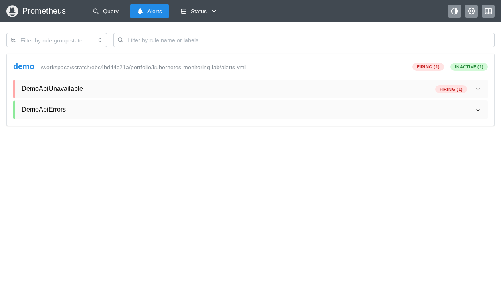

# Kubernetes Monitoring Lab

A small HTTP service exposes request counts, latency and process metrics. Prometheus scrapes one in-cluster replica every five seconds. Grafana provisions a dashboard showing availability, throughput by status code, 5xx rate and process uptime.

## Run the lab

```sh
minikube start --driver=docker
./deploy.sh
```

Start each port-forward in its own terminal.

| Component | Command | URL |
| --- | --- | --- |
| Demo API | `kubectl -n monitoring-lab port-forward svc/demo-api 8000:8000` | http://localhost:8000 |
| Prometheus | `kubectl -n monitoring-lab port-forward svc/prometheus 9090:9090` | http://localhost:9090/alerts |
| Grafana | `kubectl -n monitoring-lab port-forward svc/grafana 3000:3000` | http://localhost:3000/d/demo-api |

Grafana uses its local first-login credentials (`admin` / `admin`) and prompts for a new password. All services use ClusterIP and port-forward binds to localhost by default. Metrics and Grafana state are ephemeral.

## Generate traffic and observe recovery

```sh
./smoke.sh
for i in $(seq 1 60); do
  curl -sS -o /dev/null http://localhost:8000/
  curl -sS -o /dev/null http://localhost:8000/demo-error
  sleep 1
done
```

The 5xx panel rises during the loop. Inspect `DemoApiErrors` in the Prometheus alerts view. Prometheus evaluates the rules locally.

```sh
kubectl -n monitoring-lab scale deployment/demo-api --replicas=0
# Wait roughly 25 seconds and inspect DemoApiUnavailable.
kubectl -n monitoring-lab scale deployment/demo-api --replicas=1
kubectl -n monitoring-lab rollout status deployment/demo-api
```

The scrape availability panel recovers and process uptime starts over. Restart the API port-forward after the original pod is replaced. Delete the demo with `kubectl delete namespace monitoring-lab`.

## Local smoke test

```sh
python -m pip install -r requirements.txt
python app.py
# In another terminal:
./smoke.sh
```

## Verified local alert

Prometheus showed `DemoApiUnavailable` firing when the local demo API was stopped.


